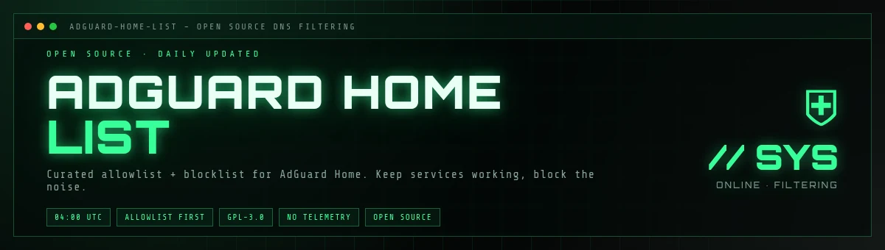
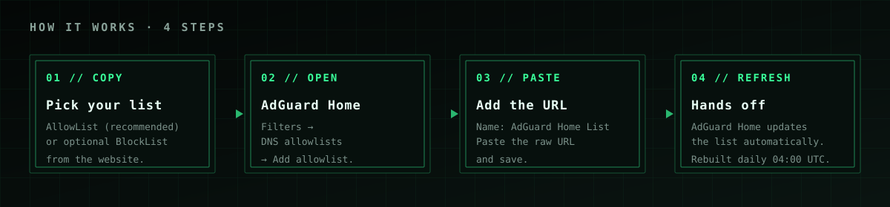

<p align="center">
  
</p>

<p align="center">
  <a href="https://fabianoflorentino.github.io/AdGuard-Home-List/"></a>
  <a href="https://github.com/fabianoflorentino/AdGuard-Home-List/blob/gh-pages/AdGuard-Home-List.Allow.txt"></a>
  <a href="https://github.com/fabianoflorentino/AdGuard-Home-List/blob/gh-pages/AdGuard-Home-List.Block.txt"></a>
  <a href="./LICENSE.txt"></a>
  <a href="https://github.com/fabianoflorentino/AdGuard-Home-List/issues"></a>
</p>

An **open source, allowlist-first** collection of DNS filtering rules for
[AdGuard Home](https://adguard.com/adguard-home/overview.html). External sources
are downloaded, cleaned, de-duplicated and consolidated into two simple lists,
rebuilt **every day at 04:00 UTC**.

> Keep the services you actually use working — CDNs, payment providers, game
> platforms, streaming, operating system updates — while ads, trackers,
> telemetry and malicious domains hit the void.

- Website: <https://fabianoflorentino.github.io/AdGuard-Home-List/>
- Usage guide: [`docs/USAGE.md`](./docs/USAGE.md)
- Issues: <https://github.com/fabianoflorentino/AdGuard-Home-List/issues>

## Table of contents

- [Quick start](#quick-start)
- [Why this project](#why-this-project)
- [Who is it for](#who-is-it-for)
- [What's inside](#whats-inside)
- [How it works](#how-it-works)
- [Sources](#sources)
- [FAQ](#faq)
- [Local development](#local-development)
- [Fork and deploy your own](#fork-and-deploy-your-own)
- [Contributing](#contributing)
- [License and credits](#license-and-credits)

## Quick start

Add the **AllowList** to AdGuard Home and you are done. The BlockList is
optional.

### AllowList — recommended

```sh
https://raw.githubusercontent.com/fabianoflorentino/AdGuard-Home-List/gh-pages/AdGuard-Home-List.Allow.txt
```

### BlockList — optional

```sh
https://raw.githubusercontent.com/fabianoflorentino/AdGuard-Home-List/gh-pages/AdGuard-Home-List.Block.txt
```

In AdGuard Home: **Filters → DNS allowlists → Add allowlist**, paste the URL,
save, then click **Check for updates**.

Need troubleshooting and a detailed walkthrough? Read the full **[usage guide](./docs/USAGE.md)**.

## Why this project

- **Allowlist first.** The main goal is to keep legitimate services working
  while filtering the noise.
- **No account, no telemetry.** Static files and a static website. Nothing to
  sign up for.
- **Daily updates.** A scheduled workflow rebuilds and republishes both lists
  every day at 04:00 UTC.
- **De-duplicated.** Multiple upstream sources are merged into a single
  normalized AdGuard-syntax list.
- **Open source.** TypeScript CLI, public workflows, static site. Read every
  line and run your own copy.
- **Portable.** Works with AdGuard Home and other tools that support AdGuard
  filtering syntax.

## Who is it for

- **Home users** running AdGuard Home on a Raspberry Pi, NAS or homelab.
- **Privacy-conscious people** who want ad/tracker filtering without breaking
  everyday services.
- **Families and small offices** that need a sane default allow/block setup.
- **Tinkerers** who want a clean, forkable base for their own lists.
- **Anyone** who prefers plain text lists over opaque blocklist services.

## What's inside

The lists combine hand-curated rules with carefully selected upstream sources:

- **CDNs and infrastructure:** Akamai, Cloudflare, Fastly, jsDelivr, Amazon.
- **Services:** Apple, Google, Microsoft, GitHub, Netflix, Spotify, Steam,
  PlayStation, Xbox, Discord and more.
- **Payments and cloud:** Coinbase, Dropbox, Salesforce, payment providers.
- **Operating system and developer tools:** updates, package registries,
  documentation.
- **Blocking:** ads, trackers, telemetry, phishing, scam and typo-squatting
  domains.

```text
allowlist/custom/     # hand-curated allow rules
blocklist/custom/     # hand-curated block rules
allowlist/external/   # upstream allow lists (AdGuard / hosts / Pi-hole)
blocklist/external/   # upstream block lists
modules/cli/          # TypeScript CLI that builds the lists
site/                 # static GitHub Pages website
docs/                 # usage guide and diagrams
```

Want a domain added or removed? Add a rule under `allowlist/custom/` or
`blocklist/custom/`, or open an issue.

## How it works



1. Custom rules from `allowlist/custom` and `blocklist/custom` are loaded.
2. External lists listed in `*.external.*.list` files are downloaded.
3. Rules are normalized to AdGuard syntax, filtered and de-duplicated.
4. The final lists, debug variants and JSON badges are written to `public/`.
5. The `publish` workflow deploys everything to the `gh-pages` branch.

The source branch is **`main`**. The generated output lives in **`gh-pages`**,
which is what GitHub Pages and the raw URLs serve.

## Sources

Rules and data come from projects maintained by other people. All credit belongs
to their authors.

**Ad / tracker / malware sources**

- [AdGuardSDNSFilter](https://adguardteam.github.io/AdGuardSDNSFilter/Filters/filter.txt)
- [AdguardTeam/cname-trackers](https://github.com/AdguardTeam/cname-trackers)
- [Adaway](https://adaway.org)
- [Yoyo.org](https://pgl.yoyo.org/adservers/)
- [firebog.net](https://firebog.net)
- [disconnect.me](https://disconnect.me)
- [phishing.army](https://phishing.army)
- [StevenBlack/hosts](https://github.com/StevenBlack/hosts)
- [crazy-max/WindowsSpyBlocker](https://github.com/crazy-max/WindowsSpyBlocker) (Spy lists)
- [blocklistproject/Lists](https://github.com/blocklistproject/Lists)
- [anudeepND/blacklist](https://github.com/anudeepND/blacklist)
- [Phishing-Database/Phishing.Database](https://github.com/Phishing-Database/Phishing.Database)
- [FadeMind/hosts.extras](https://github.com/FadeMind/hosts.extras)
- [Yhonay/antipopads](https://github.com/Yhonay/antipopads)
- [Spam404/lists](https://github.com/Spam404/lists)
- [Perflyst/PiHoleBlocklist](https://github.com/Perflyst/PiHoleBlocklist)
- [Dogino/Discord-Phishing-URLs](https://github.com/Dogino/Discord-Phishing-URLs)

**Allowlist sources**

- [hl2guide/AdGuard-Home-Whitelist](https://github.com/hl2guide/AdGuard-Home-Whitelist) (selected lists)
- [GoodnessJSON/PiHole-Whitelist](https://github.com/GoodnessJSON/PiHole-Whitelist)

## FAQ

**Is it free?**
Yes. Open source under GPL-3.0, and the lists are public.

**How often are the lists updated?**
Every day at 04:00 UTC. AdGuard Home also refreshes remote lists automatically.

**Does it collect data?**
No. The site is static and the lists are plain text. There is no analytics or
telemetry.

**Will it break streaming, games or banking?**
The allowlist is built specifically to avoid that. If something breaks, open an
issue or add an exception locally.

**Can I use it with Pi-hole?**
The generated lists use AdGuard syntax. Pi-hole expects hosts/domain format, so
they are not a drop-in replacement. See the [FAQ in the usage guide](./docs/USAGE.md#i-use-pi-hole-can-i-use-these-lists).

**How do I request a domain?**
Open an issue or a pull request. Allow and block requests are welcome.

## Local development

Requirements: **Node.js 22+**.

```sh
# Build the CLI
cd modules/cli
npm ci
npm run build
cd ../..
```

Generate the allowlist and blocklist locally (from the repository root):

```sh
node ./modules/cli/dist/main.js generate \
  --name AdGuard-Home-List.Allow.txt \
  --badge badge-allow.json \
  --external ./allowlist/external \
  --custom ./allowlist/custom \
  --concatExternal ./allowlist/concat \
  --convertToAllow true \
  --output ./dist

node ./modules/cli/dist/main.js generate \
  --name AdGuard-Home-List.Block.txt \
  --badge badge-block.json \
  --external ./blocklist/external \
  --custom ./blocklist/custom \
  --concatExternal ./blocklist/concat \
  --output ./dist
```

Preview the website locally (after copying the generated badges into `site/`, if
desired):

```sh
python3 -m http.server 8080 --directory site
```

Then open <http://localhost:8080>.

## Fork and deploy your own

This project is fully open source, so anyone can run a private or public copy.

1. Fork this repository.
2. Make sure the default branch is `main`.
3. Enable GitHub Pages: **Settings → Pages → Source: Deploy from a branch →
   Branch: `gh-pages` / `(root)`**.
4. Go to **Actions** and run the **Publish** workflow, or push a commit to
   `main`.
5. Your lists will be available at:

```text
https://raw.githubusercontent.com/<your-user>/<your-repo>/gh-pages/AdGuard-Home-List.Allow.txt
https://raw.githubusercontent.com/<your-user>/<your-repo>/gh-pages/AdGuard-Home-List.Block.txt
```

The workflow needs `contents: write` permission (already configured) to publish
to `gh-pages`.

## Contributing

Contributions are welcome — new allow rules, false-positive fixes, new upstream
sources, documentation and website improvements.

- Add custom rules under `allowlist/custom/` or `blocklist/custom/`.
- Add upstream sources to the matching `*.external.*.list` file.
- Open an issue for a domain request or bug report.
- Read [CONTRIBUTING.md](./CONTRIBUTING.md) before opening a pull request.

## License and credits

- Licensed under the **GNU General Public License v3.0** — see
  [LICENSE.txt](./LICENSE.txt).
- Originally inspired by and forked from
  [Ealenn/AdGuard-Home-List](https://github.com/Ealenn/AdGuard-Home-List).
  Thanks to the original author and to every upstream list maintainer.
