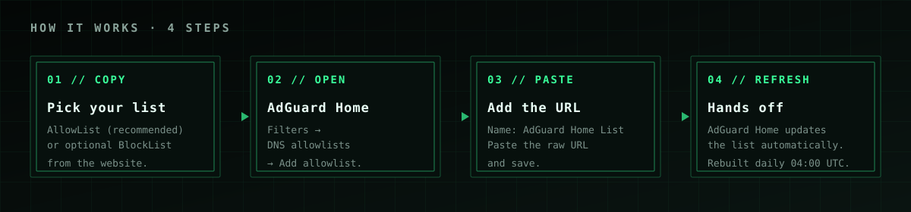
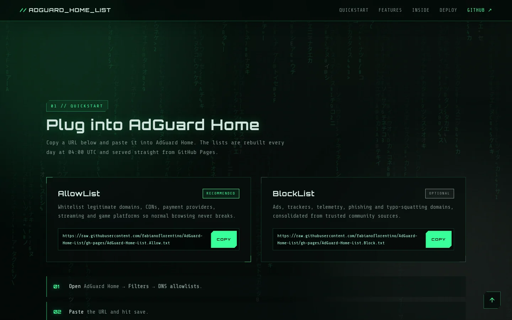
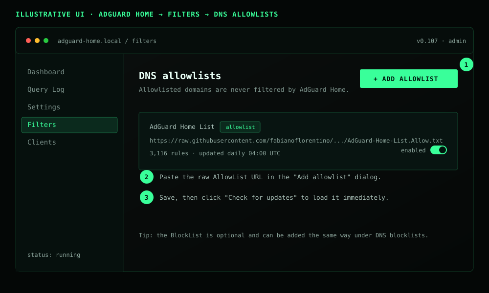

# How to use AdGuard Home List

This guide shows how to add the lists to **AdGuard Home** in about two minutes.



## What you need

- A working [AdGuard Home](https://adguard.com/adguard-home/overview.html) instance.
- Access to the AdGuard Home admin dashboard.
- Nothing else. The lists are public, require no account and have no telemetry.

## 1. Copy the list URL

Open the project website:

<https://fabianoflorentino.github.io/AdGuard-Home-List/>

In the **Quickstart** section, copy the **AllowList** URL (recommended). The
**BlockList** is optional.



If you prefer the raw URLs directly:

```sh
# AllowList (recommended)
https://raw.githubusercontent.com/fabianoflorentino/AdGuard-Home-List/gh-pages/AdGuard-Home-List.Allow.txt

# BlockList (optional)
https://raw.githubusercontent.com/fabianoflorentino/AdGuard-Home-List/gh-pages/AdGuard-Home-List.Block.txt
```

## 2. Add the AllowList to AdGuard Home

In AdGuard Home:

1. Open **Filters** in the left menu.
2. Go to **DNS allowlists**.
3. Click **Add allowlist**.
4. Give it a name, for example `AdGuard Home List`.
5. Paste the AllowList URL and save.
6. Click **Check for updates** to load it immediately.



The screen above is illustrative; the exact layout depends on your AdGuard Home
version.

## 3. Optional: add the BlockList

Repeat the same steps under **Filters → DNS blocklists** and paste the BlockList
URL.

You can safely use the allowlist without the blocklist, or combine it with your
own blocklists.

## 4. Verify that it worked

- Go back to **Filters** and confirm the list is enabled and shows a rule count.
- Open **Query Log** and check that queries are being filtered.
- If a domain you need is being blocked, add it to your allowlist (see below).

## How updates work

- The project rebuilds both lists **every day at 04:00 UTC** via GitHub Actions.
- AdGuard Home refreshes filter lists automatically (usually once every 24
  hours).
- You can force a refresh at any time with **Check for updates**.

The raw URLs are stable, so you only need to add them once.

## Troubleshooting

### The list shows 0 rules or fails to download

1. Open the raw URL directly in your browser and confirm it returns text.
2. Check that your AdGuard Home server can reach `raw.githubusercontent.com`.
3. Try **Check for updates** again.
4. If GitHub is temporarily unavailable, wait and retry later.

### A site or service stopped working

The allowlist is designed to prevent that, but false positives can happen.
Options:

- Add the domain to your own AdGuard Home **custom filtering rules** as an
  exception: `@@||example.com^$important`.
- Or contribute the fix to this project by adding the domain under
  `allowlist/custom/` (see [Contributing](../CONTRIBUTING.md)).

### I use Pi-hole, can I use these lists?

These generated lists use **AdGuard syntax** (`@@||domain^$important`,
`||domain^`). Pi-hole expects **hosts** or **domain** format, so the generated
files are not a drop-in replacement.

If you use Pi-hole, keep using the upstream hosts sources listed in the
[README](../README.md#sources), or convert the lists to a compatible format.

### I want my own branded copy

Fork the repository, enable GitHub Pages from the `gh-pages` branch and run the
**Publish** workflow. See [Fork and deploy your own](../README.md#fork-and-deploy-your-own).

## FAQ

**Is it free?**
Yes. The project is open source under GPL-3.0 and the lists are public.

**Do you collect data?**
No. The website is static and the lists are plain text files. There is no
analytics and no telemetry.

**Which AdGuard Home versions are supported?**
Any version that supports AdGuard filtering syntax and remote filter lists.

**Can I use only the allowlist?**
Yes. That is the main use case. The blocklist is optional.

**How can I request a domain?**
Open an issue or a pull request. Allow and block requests are welcome.
